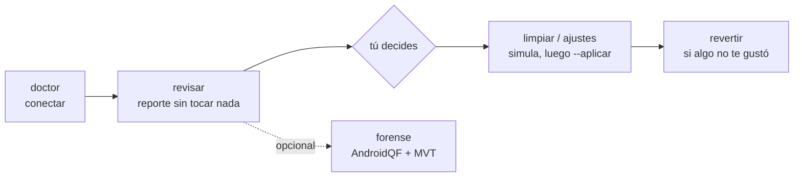

<div align="center">

# 📱🧹 android-limpio

**Tu celular trae de fábrica apps que pueden instalar otras apps sin preguntarte.**
**Encuéntralas, entiende qué hacen y decide qué se queda. Sin root y con vuelta atrás.**

[](LICENSE)
[](https://www.python.org/)
[](#cómo-funciona)
[](#funciona-con-tu-agente)

[Empezar](#empezar-en-2-minutos) · [Qué encuentra](#qué-encuentra) · [Seguridad](#lo-que-nunca-hace) · [Contribuir](#contribuir)

</div>

---

## Por qué

Muchos Android vienen con software de fábrica que **tiene permiso de sistema para instalar y borrar apps sin pasar por Play Store**: el Meta App Installer (`com.facebook.system`) en Samsung y Motorola, Aura de ironSource, Digital Turbine, los contenedores de operadora. No lo instalaste, no aparece en tu cajón de apps y casi nadie sabe que está ahí.

Eso es una **capacidad**, no prueba de que te espíen, y aquí se dice así, con fuentes. Lo que `android-limpio` hace es mostrártelo, explicarlo y dejarte decidir.

La otra mitad es **no romper nada**. Hay paquetes que parecen basura y no lo son: quitar `com.samsung.android.kgclient` (Knox Guard) deja un Samsung bloqueado hasta borrarlo de fábrica. Cada paquete se cruza con la lista de [Universal Android Debloater](https://github.com/Universal-Debloater-Alliance/universal-android-debloater-next-generation) y lo peligroso **no se toca**.

## Qué encuentra

Ejemplo real, resumido, de un Galaxy S25 Ultra:

```text
$ ./limpio revisar
Revisar ya: 1 · Fábrica conocido: 6 · Sin usar y seguras de quitar: 134 · No tocar: 44
```

| | Paquete | Qué es | Recomendación |
|---|---|---|---|
| 🟠 | `com.facebook.system` | Meta App Installer, con permiso de instalar y borrar apps | quitar |
| 🟠 | `com.facebook.appmanager` | Actualiza apps de Meta por fuera de Play Store | quitar |
| 🟠 | `com.samsung.android.rubin.app` | Aprende cómo usas el equipo para personalizar contenido | congelar |
| 🔴 | `com.samsung.android.kgclient` | Knox Guard: administrador del equipo, puede bloquearlo a distancia | **no tocar** |
| 🟡 | 134 apps de sistema | Preinstaladas que nunca abriste y que se pueden quitar sin romper nada | tú decides |

También revisa: quién instaló cada app (y si alguna entró como APK a mano), administradores del equipo, apps con accesibilidad, quién lee tus notificaciones y quién tiene permiso de instalar apps.

## Empezar en 2 minutos

**En el celular:** Ajustes → Acerca del teléfono → toca 7 veces «Número de compilación» → Opciones de desarrollador → **Depuración USB**. En Samsung, apaga antes el **Bloqueador automático** (Ajustes → Seguridad y privacidad). Conecta con cable de datos y acepta «Permitir siempre desde esta computadora».

**En la computadora** necesitas [adb](https://developer.android.com/tools/releases/platform-tools) y Python 3.8+.

### Con tu agente

```bash
git clone https://github.com/AnthonySmith96/android-limpio && cd android-limpio
```

Abre la carpeta con tu agente y dile: **«revisa mi celular»**. La skill le explica qué hacer, qué preguntarte y qué no tocar nunca. Se adapta a la marca que tengas.

### Sin agente

```bash
./limpio doctor                      # ¿la computadora ve el celular?
./limpio revisar                     # reporte, sin tocar nada
./limpio limpiar com.facebook.system com.facebook.appmanager com.facebook.services            # simula
./limpio limpiar com.facebook.system com.facebook.appmanager com.facebook.services --aplicar  # lo hace
./limpio revertir --aplicar          # deshace todo
```

En Windows: `python .agents\skills\android-limpio\scripts\limpio.py` en lugar de `./limpio`.

## Cómo funciona



| Comando | Qué hace | ¿Cambia el celular? |
|---|---|---|
| `doctor` | Revisa la conexión y te dice qué falta | No |
| `revisar` | Reporte: lo urgente, lo de fábrica, lo que no usas, lo que no se toca | No |
| `limpiar` | Quita, o congela si el fabricante no deja quitar | Sólo con `--aplicar` |
| `ajustes` | Animaciones más rápidas, DNS que bloquea anuncios, quitar permiso de instalar apps | Sólo con `--aplicar` |
| `revertir` | Deshace lo anterior | Sólo con `--aplicar` |
| `forense` | Busca spyware conocido con [AndroidQF](https://github.com/mvt-project/androidqf) y [MVT](https://docs.mvt.re/) de Amnesty International | No |
| `aporte` | Resumen anónimo de tu modelo para mejorar el repo | No |

Sin root: lo que se quita desaparece para tu usuario y el sistema queda intacto. Un solo archivo de Python, sin dependencias. Detalles en [PROTOCOLO.md](.agents/skills/android-limpio/referencias/PROTOCOLO.md).

## Lo que nunca hace

- 🛑 **Tocar lo peligroso.** Lo que UAD marca como `Unsafe` (Knox Guard, la interfaz del sistema…) no se toca, aunque lo pidas.
- ✋ **Cambiar algo sin que lo pidas.** Todo simula primero; sólo `--aplicar` hace cambios.
- ↩️ **Dejarte sin salida.** Cada cambio queda registrado y `revertir` lo deshace.
- 🔒 **Sacar tus datos.** Todo se queda en tu computadora (`~/android-limpio-resultados/`). Los reportes no guardan tu número de serie. `forense` no copia tus SMS ni descarga tus apps.
- 📢 **Exagerar.** Si algo puede instalar apps, dice que *puede*; no que te esté espiando.

## Funciona con tu agente

Es una [Agent Skill](https://agentskills.io/specification), el formato abierto que leen casi todos los agentes:

| Agente | Dónde la encuentra |
|---|---|
| [Codex](https://developers.openai.com/codex/skills) | `.agents/skills/` |
| [Gemini CLI](https://geminicli.com/docs/cli/skills) | `.agents/skills/` |
| [Antigravity](https://antigravity.google/docs/skills) | `.agents/skills/` |
| [OpenCode](https://opencode.ai/docs/skills/) | `.agents/skills/` y `.claude/skills/` |
| Claude Code | `.claude/skills/` (enlace a la misma carpeta) |
| Cualquier otro | `AGENTS.md` lo manda a la skill |

¿La quieres en todos tus proyectos? `./instalar.sh` la enlaza en `~/.agents/skills/` y `~/.claude/skills/`.

## Límites

- Sin root no se borra de verdad una app de sistema: vuelve si restableces de fábrica.
- Una actualización mayor del sistema puede regresar la basura. Vuelve a correr `revisar`.
- `forense` sólo detecta spyware **conocido**. Si temes un ataque dirigido, busca ayuda: [Amnesty Security Lab](https://securitylab.amnesty.org/get-help/) o [Access Now](https://www.accessnow.org/help/).

## Contribuir

Cada marca y cada operadora traen basura distinta. Lo que tu agente aprenda en tu equipo le sirve al siguiente:

- 📋 Al terminar, el agente te ofrece correr `aporte`: un resumen de tu **modelo** (instaladores de fábrica, apps de operadora sin clasificar, qué no se dejó quitar), sin tus apps ni tus datos. Lo revisas y, si quieres, se abre como [issue](https://github.com/AnthonySmith96/android-limpio/issues).
- 🔍 ¿Algo que debería estar en [`conocidos.json`](.agents/skills/android-limpio/datos/conocidos.json)? PR con una fuente pública.
- ⭐ **Si te sirvió, deja una estrella.** Ayuda a que más gente lo encuentre.

## Créditos

- [Universal Android Debloater Next Generation](https://github.com/Universal-Debloater-Alliance/universal-android-debloater-next-generation): la lista de qué es seguro quitar (GPL-3.0; se descarga al usarla, no se redistribuye).
- [MVT](https://github.com/mvt-project/mvt) y [AndroidQF](https://github.com/mvt-project/androidqf), de Amnesty International.

---

<details>
<summary><b>English</b></summary>

`android-limpio` audits an Android phone over adb (no root) before debloating it. It flags factory-installed app installers (Meta App Installer, ironSource Aura, Digital Turbine, carrier containers), sideloaded apps, device admins, accessibility services and risky permissions; removes only what you approve; refuses packages that would brick the phone (UAD "Unsafe" list); logs every change for one-command rollback; and optionally runs an AndroidQF + MVT spyware check. Works standalone (single Python 3.8+ file, stdlib only) or as an Agent Skill for Claude Code, Codex, Gemini CLI, Antigravity and OpenCode. Docs are in Spanish; issues and PRs in English are welcome.

</details>

Licencia [MIT](LICENSE).
